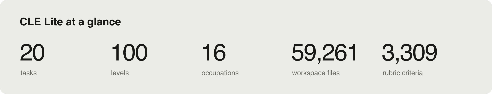
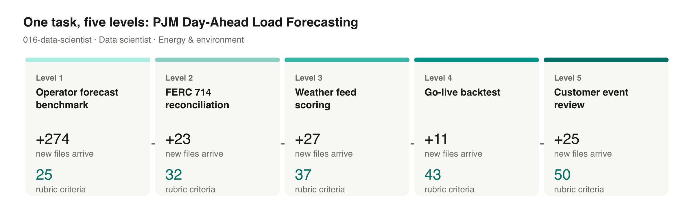
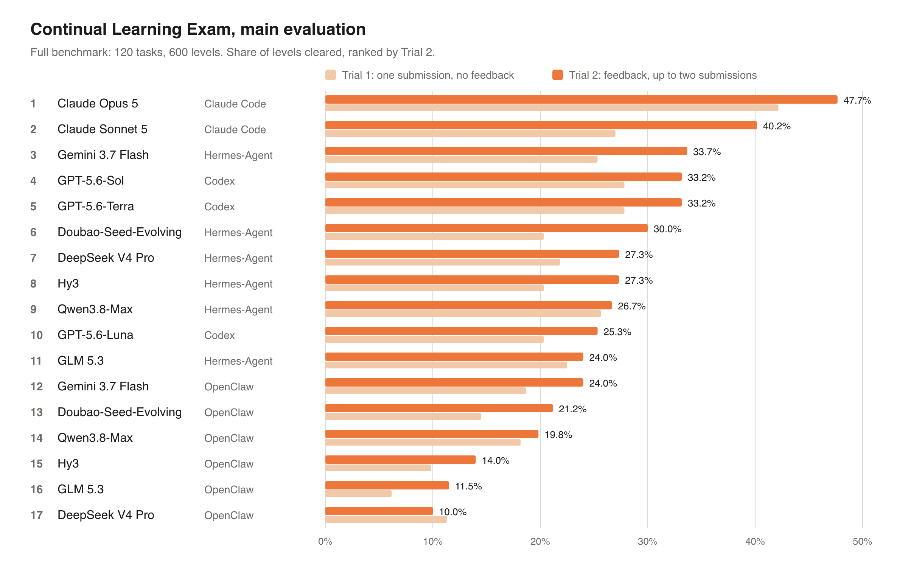

<p align="center">
  <a href="https://haoyu-zhao.github.io/CLE/">
    
  </a>
</p>

<h1 align="center">Continual Learning Exam</h1>

<p align="center">
  Evaluating how agents acquire, retain, and reuse experience across professional workflows.
</p>

<p align="center">
  <a href="https://haoyu-zhao.github.io/CLE/contributors/"><strong>CLE Team</strong></a>
</p>

<p align="center">
  <a href="https://haoyu-zhao.github.io/CLE/"></a>
  <a href="https://haoyu-zhao.github.io/CLE/assets/continual-learning-exam.pdf"></a>
  <a href="https://huggingface.co/datasets/Continual-Learning-Exam/CLE-Lite"></a>
  <a href="https://haoyu-zhao.github.io/CLE/leaderboard/"></a>
</p>

<p align="center">
  120 tasks · 600 levels · 17 agent configurations
</p>

[Quick Start](#quick-start) · [Tasks](#tasks) · [Results](#model-leaderboard) · [Release checklist](#todo) · [Citation](#citation)

## About CLE

**Continual Learning Exam (CLE)** measures whether agents can learn from experience and use it in later work. Built by **50+ domain experts**, the benchmark contains **120 human-authored tasks**, spanning **89 professional roles** across **12 domains**.

Each task contains **five connected assignments**. Passing a level unlocks the next, while files, environment state, and accumulated experience carry forward.

<details>
<summary><strong>Explore the full benchmark and what carries forward</strong></summary>

<p align="center">
  <a href="https://haoyu-zhao.github.io/CLE/#coverage-title">
    
  </a>
</p>

[Explore the interactive breakdown →](https://haoyu-zhao.github.io/CLE/#coverage-title)

Each task is a ladder of **five connected assignments**, giving **600 levels** in total. Passing a level unlocks the next; files, environment state, and accumulated experience carry forward. Human-authored rubrics determine whether each submission passes.

<p align="center">
  <a href="https://haoyu-zhao.github.io/CLE/#carry">
    
  </a>
</p>

[Explore this example →](https://haoyu-zhao.github.io/CLE/#carry) · [Benchmark design](https://haoyu-zhao.github.io/CLE/docs/)

</details>

## Quick Start

Start with **[CLE Lite](https://huggingface.co/datasets/Continual-Learning-Exam/CLE-Lite)**: 20 professional tasks, each with five connected levels. Its public homepage contains 100 task cards and a [Quick Start](https://huggingface.co/datasets/Continual-Learning-Exam/CLE-Lite#quick-start) for running an example. Download runnable packages from **CLE-Lite-Full**; the resources are listed below.

| Resource | Contents | Access |
| :--- | :--- | :--- |
| [Task Cards](https://huggingface.co/datasets/Continual-Learning-Exam/CLE-Lite) | All 100 assignments and their input-file inventories | Public |
| [Task Inputs](https://huggingface.co/datasets/Continual-Learning-Exam/CLE-Lite-Workspaces) | Instructions and files supplied to agents | Public |
| [Full Archive](https://huggingface.co/datasets/Continual-Learning-Exam/CLE-Lite-Full) | Complete task packages, container environments, and evaluation material | Approval required |
| [References](https://huggingface.co/datasets/Continual-Learning-Exam/CLE-Lite-Rubrics) | Evaluation rubrics and reference answers | Approval required |

To inspect a complete task, [request access to the archive](https://huggingface.co/datasets/Continual-Learning-Exam/CLE-Lite-Full). Once approved, sign in and download the equity research analyst example:

```bash
pip install -U huggingface_hub
hf auth login

hf download Continual-Learning-Exam/CLE-Lite-Full \
  --repo-type dataset \
  --include '001-equity-research-analyst/**' \
  --local-dir ./CLE-Lite

cat ./CLE-Lite/001-equity-research-analyst/harbor/task/instruction.md
```

To run an agent and score its work, follow the [CLE Lite Quick Start](https://huggingface.co/datasets/Continual-Learning-Exam/CLE-Lite#quick-start) and [evaluation guide](https://github.com/haoyu-zhao/Continual-Learning-Exam/blob/main/docs/evaluation.md). The packaged runtime downloads and verifies a task, prepares its grader, and runs all five levels. The verified setup uses Linux, Docker, and Codex; it requires model access and at least 30 GB of disk space for the example task. Use the runtime's download command for evaluation so that file permissions and timestamps match the recorded release.

For reproducible experiments, record the task and runtime revisions, model, and evaluation harness. The evaluation guide pins both revisions for its verified example. Cite the [CLE manuscript](#citation) and identify the CLE Lite dataset revision, as described in the [dataset citation guide](https://huggingface.co/datasets/Continual-Learning-Exam/CLE-Lite#citation).

The Lite example runs all five levels before grading. The [evaluation guide](https://github.com/haoyu-zhao/Continual-Learning-Exam/blob/main/docs/evaluation.md#relationship-to-the-main-experiment) explains how its protocol and judge configuration differ from the main experiment's Trial 1 and Trial 2.

## Tasks

<p align="center">
  <a href="assets/readme/cle-lite-glance.png">
    
  </a>
</p>

Explore selected public task examples in the task browser, with level instructions and their input materials. For downloadable packages, **CLE Lite** provides **20 tasks and 100 levels**. The main evaluation covers the full 120-task benchmark.

| Resource | What you can explore |
| :--- | :--- |
| [Task browser](https://haoyu-zhao.github.io/CLE/tasks/) | Read assignments, follow dependencies across levels, and preview files. |
| [CLE Lite task cards](https://huggingface.co/datasets/Continual-Learning-Exam/CLE-Lite) | Browse all 100 CLE Lite level instructions in the Hugging Face Dataset Viewer. |
| [CLE Lite task inputs](https://huggingface.co/datasets/Continual-Learning-Exam/CLE-Lite-Workspaces) | Download the agent-facing files for the 20 CLE Lite tasks. |

### One task, five connected levels

In **PJM Day-Ahead Load Forecasting**, the agent benchmarks operator forecasts, reconciles FERC 714 load data, scores weather feeds, backtests the forecaster, and reviews customer events. Each assignment adds inputs and builds on earlier work.

<p align="center">
  <a href="assets/readme/cle-lite-levels.png">
    
  </a>
</p>

[Explore the task files](https://huggingface.co/datasets/Continual-Learning-Exam/CLE-Lite-Workspaces/tree/main/016-data-scientist) · [Figure data and counting method](assets/readme/README.md)

## Model Leaderboard

The main evaluation compares **17 configurations** spanning **11 model variants** and **4 harnesses**: Claude Code, Codex, Hermes-Agent, and OpenClaw. Each row identifies the model and its harness; results reflect the complete configuration.

Trial 1 allows one submission per level. Trial 2 adds diagnostic feedback after a failed submission and one opportunity to revise.

<p align="center">
  <a href="assets/readme/cle-leaderboard.png">
    
  </a>
</p>

[Interactive leaderboard](https://haoyu-zhao.github.io/CLE/leaderboard/) · [Completion Rate](#completion-rate) · [Gain](#gain)

### Completion Rate

<details>
<summary><strong>View all 17 configurations and exact completion rates</strong></summary>

Ranked by **Trial 2 completion across all 600 levels**.

| Rank | Model | Harness | Completion Rate |
| :---: | :--- | :--- | ---: |
| 🥇 | **Claude Opus 5** | Claude Code | **47.67%** |
| 🥈 | **Claude Sonnet 5** | Claude Code | **40.17%** |
| 🥉 | **Gemini 3.7 Flash** | Hermes-Agent | **33.67%** |
| 4 | GPT-5.6-Sol | Codex | 33.17% |
| 5 | GPT-5.6-Terra | Codex | 33.17% |
| 6 | Doubao-Seed-Evolving | Hermes-Agent | 30.00% |
| 7 | DeepSeek V4 Pro | Hermes-Agent | 27.33% |
| 8 | Hy3 | Hermes-Agent | 27.33% |
| 9 | Qwen3.8-Max | Hermes-Agent | 26.67% |
| 10 | GPT-5.6-Luna | Codex | 25.33% |
| 11 | Gemini 3.7 Flash | OpenClaw | 24.00% |
| 12 | GLM 5.3 | Hermes-Agent | 24.00% |
| 13 | Doubao-Seed-Evolving | OpenClaw | 21.17% |
| 14 | Qwen3.8-Max | OpenClaw | 19.83% |
| 15 | Hy3 | OpenClaw | 14.00% |
| 16 | GLM 5.3 | OpenClaw | 11.50% |
| 17 | DeepSeek V4 Pro | OpenClaw | 10.00% |

</details>

### Gain

<details>
<summary><strong>View feedback and revision gains for all 17 configurations</strong></summary>

Ranked by **Trial 2 − Trial 1**, in percentage points. Ties are ordered by Trial 2 completion, then model name.

| Rank | Model | Harness | Gain (pp) | Trial 1 | Trial 2 |
| :---: | :--- | :--- | ---: | ---: | ---: |
| 🥇 | **Claude Sonnet 5** | Claude Code | **+13.17** | 27.00% | 40.17% |
| 🥈 | **Doubao-Seed-Evolving** | Hermes-Agent | **+9.67** | 20.33% | 30.00% |
| 🥉 | **Gemini 3.7 Flash** | Hermes-Agent | **+8.33** | 25.33% | 33.67% |
| 4 | Hy3 | Hermes-Agent | +7.00 | 20.33% | 27.33% |
| 5 | Doubao-Seed-Evolving | OpenClaw | +6.67 | 14.50% | 21.17% |
| 6 | Claude Opus 5 | Claude Code | +5.50 | 42.17% | 47.67% |
| 7 | DeepSeek V4 Pro | Hermes-Agent | +5.50 | 21.83% | 27.33% |
| 8 | GPT-5.6-Sol | Codex | +5.33 | 27.83% | 33.17% |
| 9 | GPT-5.6-Terra | Codex | +5.33 | 27.83% | 33.17% |
| 10 | Gemini 3.7 Flash | OpenClaw | +5.33 | 18.67% | 24.00% |
| 11 | GLM 5.3 | OpenClaw | +5.33 | 6.17% | 11.50% |
| 12 | GPT-5.6-Luna | Codex | +5.00 | 20.33% | 25.33% |
| 13 | Hy3 | OpenClaw | +4.17 | 9.83% | 14.00% |
| 14 | Qwen3.8-Max | OpenClaw | +1.67 | 18.17% | 19.83% |
| 15 | GLM 5.3 | Hermes-Agent | +1.50 | 22.50% | 24.00% |
| 16 | Qwen3.8-Max | Hermes-Agent | +1.00 | 25.67% | 26.67% |
| 17 | DeepSeek V4 Pro | OpenClaw | −1.33 | 11.33% | 10.00% |

</details>

[Explore the interactive leaderboard →](https://haoyu-zhao.github.io/CLE/leaderboard/) · [Download results (CSV)](https://haoyu-zhao.github.io/CLE/data/results.csv)

## Todo

- [ ] Release the paper and project website.
- [ ] Release **CLE Lite**.
- [ ] Release **Harbor support for CLE Lite**.

Paper and website previews are available through the links above; the checklist tracks the formal releases.

## Citation

For now, please use the provisional manuscript citation:

```bibtex
@misc{cle2026continual,
  title  = {Continual Learning Exam},
  author = {{CLE Team}},
  year   = {2026},
  note   = {Manuscript},
  url    = {https://haoyu-zhao.github.io/CLE/}
}
```
