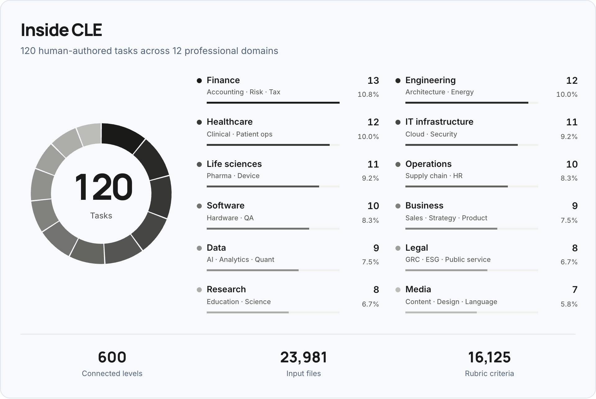
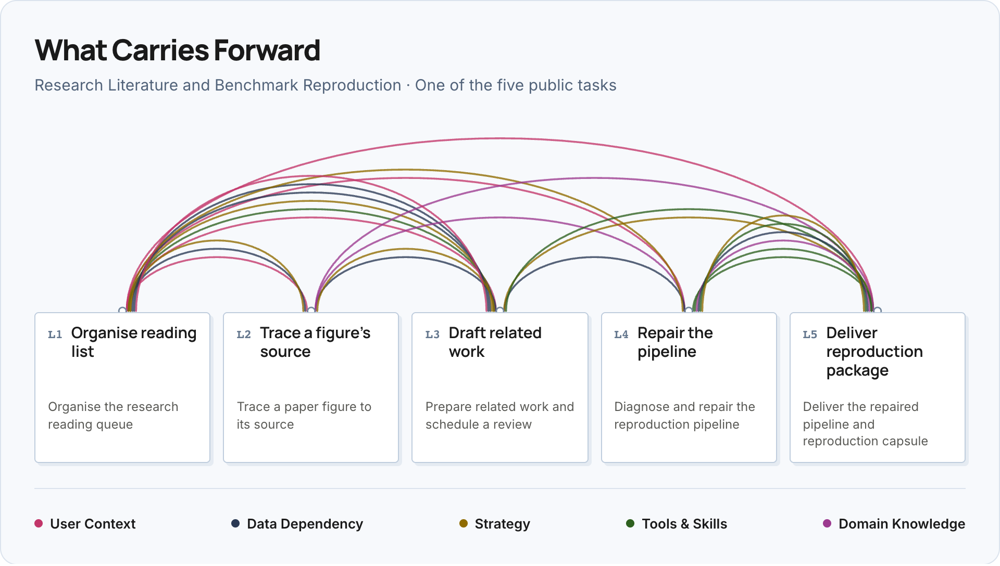

<p align="center">
  <a href="https://haoyu-zhao.github.io/CLE/">
    
  </a>
</p>

<h1 align="center">Continual Learning Exam</h1>

<p align="center">
  Evaluating how agents acquire, retain, and reuse experience across professional workflows.
</p>

<p align="center">
  <a href="https://haoyu-zhao.github.io/CLE/contributors/"><strong>CLE Team</strong></a>
</p>

<p align="center">
  <a href="#tasks"></a>
  <a href="#model-leaderboard"></a>
  <a href="#model-leaderboard"></a>
  <a href="https://haoyu-zhao.github.io/CLE/leaderboard/"></a>
</p>

<p align="center">
  <a href="https://haoyu-zhao.github.io/CLE/"></a>
  <a href="https://haoyu-zhao.github.io/CLE/assets/continual-learning-exam.pdf"></a>
  <a href="https://huggingface.co/Continual-Learning-Exam"></a>
</p>

<p align="center">
  <a href="#todo"></a>
  <a href="#todo"></a>
  <a href="#todo"></a>
</p>

## About CLE

**Continual Learning Exam (CLE)** measures whether agents can learn from experience and use it in later work. Built by **50+ domain experts**, the benchmark contains **120 human-authored tasks**, spanning **89 professional roles** across **12 domains**.

<p align="center">
  <a href="https://haoyu-zhao.github.io/CLE/#coverage-title">
    
  </a>
</p>

[Explore the interactive breakdown →](https://haoyu-zhao.github.io/CLE/#coverage-title)

Each task is a ladder of **five connected assignments**, giving **600 levels** in total. Passing a level unlocks the next; files, environment state, and accumulated experience carry forward. Human-authored rubrics determine whether each submission passes.

<p align="center">
  <a href="https://haoyu-zhao.github.io/CLE/#carry">
    
  </a>
</p>

[Explore this example →](https://haoyu-zhao.github.io/CLE/#carry) · [Benchmark design](https://haoyu-zhao.github.io/CLE/docs/)

## Todo

- [ ] Release the paper and project website.
- [ ] Release **CLE Lite**.
- [ ] Release **Harbor support for CLE Lite**.

Paper and website previews are available through the links above; the checklist tracks the formal releases.

## Tasks

Explore **five public task examples**, with all **25 level instructions** and their input materials. These examples provide a closer look at CLE; the main evaluation covers the full 120-task benchmark.

| Resource | What you can explore |
| :--- | :--- |
| [Task browser](https://haoyu-zhao.github.io/CLE/tasks/) | Read assignments, follow dependencies across levels, and preview files. |
| [Task cards](https://huggingface.co/datasets/Continual-Learning-Exam/CLE-Tasks) | Browse the 25 instructions in the Hugging Face Dataset Viewer. |
| [Task inputs](https://huggingface.co/datasets/Continual-Learning-Exam/CLE-Task-Inputs) | Download the agent-facing files for the five public examples. |

## Model Leaderboard

The main evaluation compares **17 configurations** spanning **11 model variants** and **4 harnesses**: Claude Code, Codex, Hermes-Agent, and OpenClaw. Each row identifies the model and its harness; results reflect the complete configuration.

Trial 1 allows one submission per level. Trial 2 adds diagnostic feedback after a failed submission and one opportunity to revise.

[Completion Rate](#completion-rate) · [Gain](#gain)

### Completion Rate

Ranked by **Trial 2 completion across all 600 levels**.

| Rank | Model | Harness | Completion Rate |
| :---: | :--- | :--- | ---: |
| 🥇 | **Claude Opus 5** | Claude Code | **47.67%** |
| 🥈 | **Claude Sonnet 5** | Claude Code | **40.17%** |
| 🥉 | **Gemini 3.7 Flash** | Hermes-Agent | **33.67%** |
| 4 | GPT-5.6-Sol | Codex | 33.17% |
| 5 | GPT-5.6-Terra | Codex | 33.17% |
| 6 | Doubao-Seed-Evolving | Hermes-Agent | 30.00% |
| 7 | DeepSeek V4 Pro | Hermes-Agent | 27.33% |
| 8 | Hy3 | Hermes-Agent | 27.33% |
| 9 | Qwen3.8-Max | Hermes-Agent | 26.67% |
| 10 | GPT-5.6-Luna | Codex | 25.33% |
| 11 | Gemini 3.7 Flash | OpenClaw | 24.00% |
| 12 | GLM 5.3 | Hermes-Agent | 24.00% |
| 13 | Doubao-Seed-Evolving | OpenClaw | 21.17% |
| 14 | Qwen3.8-Max | OpenClaw | 19.83% |
| 15 | Hy3 | OpenClaw | 14.00% |
| 16 | GLM 5.3 | OpenClaw | 11.50% |
| 17 | DeepSeek V4 Pro | OpenClaw | 10.00% |

### Gain

Ranked by **Trial 2 − Trial 1**, in percentage points. Ties are ordered by Trial 2 completion, then model name.

| Rank | Model | Harness | Gain (pp) | Trial 1 | Trial 2 |
| :---: | :--- | :--- | ---: | ---: | ---: |
| 🥇 | **Claude Sonnet 5** | Claude Code | **+13.17** | 27.00% | 40.17% |
| 🥈 | **Doubao-Seed-Evolving** | Hermes-Agent | **+9.67** | 20.33% | 30.00% |
| 🥉 | **Gemini 3.7 Flash** | Hermes-Agent | **+8.33** | 25.33% | 33.67% |
| 4 | Hy3 | Hermes-Agent | +7.00 | 20.33% | 27.33% |
| 5 | Doubao-Seed-Evolving | OpenClaw | +6.67 | 14.50% | 21.17% |
| 6 | Claude Opus 5 | Claude Code | +5.50 | 42.17% | 47.67% |
| 7 | DeepSeek V4 Pro | Hermes-Agent | +5.50 | 21.83% | 27.33% |
| 8 | GPT-5.6-Sol | Codex | +5.33 | 27.83% | 33.17% |
| 9 | GPT-5.6-Terra | Codex | +5.33 | 27.83% | 33.17% |
| 10 | Gemini 3.7 Flash | OpenClaw | +5.33 | 18.67% | 24.00% |
| 11 | GLM 5.3 | OpenClaw | +5.33 | 6.17% | 11.50% |
| 12 | GPT-5.6-Luna | Codex | +5.00 | 20.33% | 25.33% |
| 13 | Hy3 | OpenClaw | +4.17 | 9.83% | 14.00% |
| 14 | Qwen3.8-Max | OpenClaw | +1.67 | 18.17% | 19.83% |
| 15 | GLM 5.3 | Hermes-Agent | +1.50 | 22.50% | 24.00% |
| 16 | Qwen3.8-Max | Hermes-Agent | +1.00 | 25.67% | 26.67% |
| 17 | DeepSeek V4 Pro | OpenClaw | −1.33 | 11.33% | 10.00% |

[Explore the interactive leaderboard →](https://haoyu-zhao.github.io/CLE/leaderboard/) · [Download results (CSV)](https://haoyu-zhao.github.io/CLE/data/results.csv)

## Quick Start

Todo

## Citation

For now, please use the provisional manuscript citation:

```bibtex
@misc{cle2026continual,
  title  = {Continual Learning Exam},
  author = {{CLE Team}},
  year   = {2026},
  note   = {Manuscript},
  url    = {https://haoyu-zhao.github.io/CLE/}
}
```
