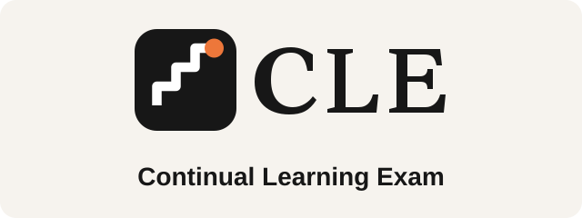
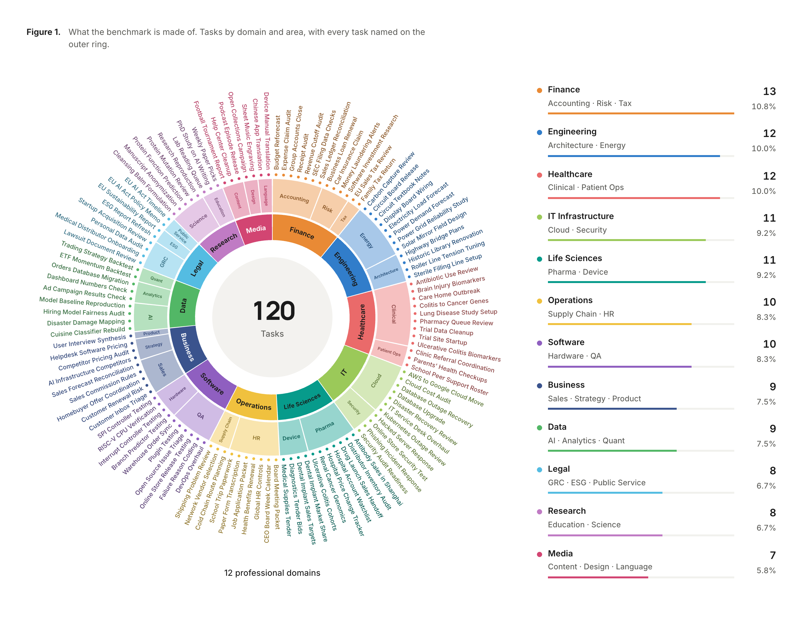
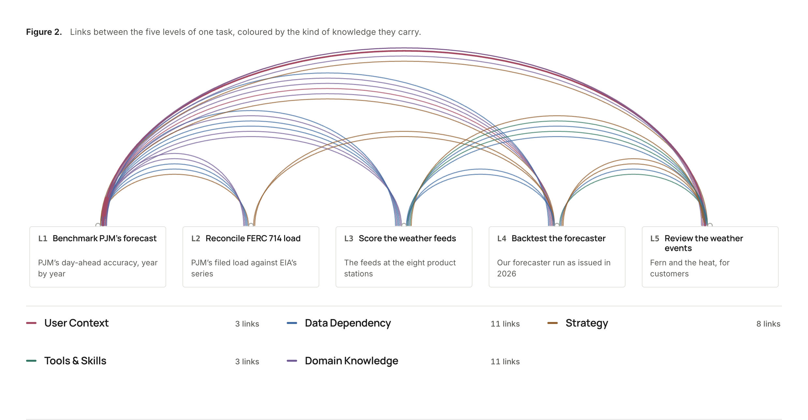
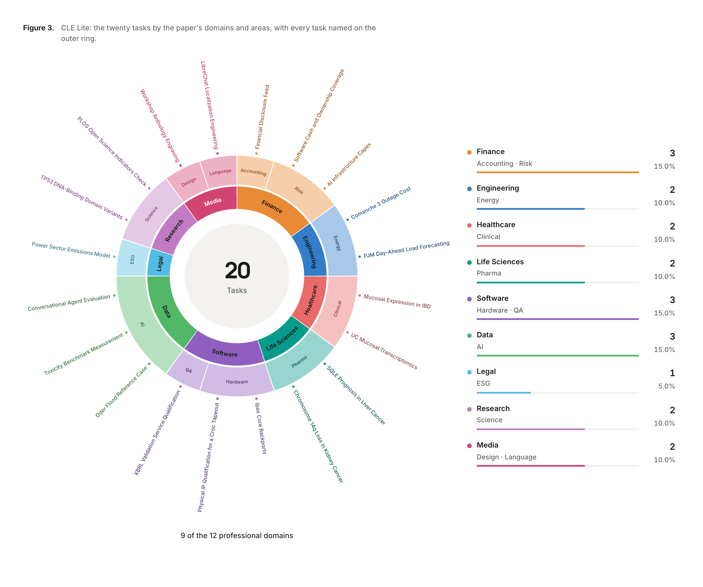
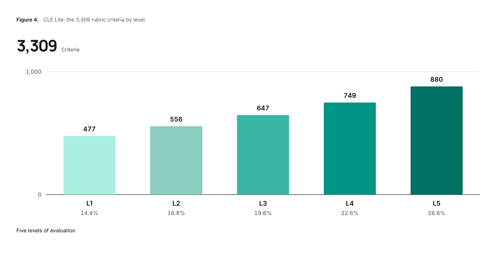

<h1 align="center">
  <a href="https://haoyu-zhao.github.io/CLE/"></a>
</h1>

<p align="center">
  Evaluating how agents acquire, retain, and reuse experience across professional workflows.
</p>

<p align="center">
  <a href="https://haoyu-zhao.github.io/CLE/contributors/"><strong>CLE Team</strong></a>
  <br>
  <strong>120</strong> Professional Tasks · <strong>5</strong> Connected Levels per Task · <strong>600</strong> Assignments
</p>

<p align="center">
  <a href="#tasks"></a>
  <a href="#model-leaderboard"></a>
  <a href="#model-leaderboard"></a>
  <a href="https://haoyu-zhao.github.io/CLE/leaderboard/"></a>
</p>

<p align="center">
  <a href="https://haoyu-zhao.github.io/CLE/"></a>
  <a href="https://arxiv.org/abs/2610.33956"></a>
  <a href="https://huggingface.co/papers/2610.33956"></a>
</p>

<p align="center">
  <a href="#news">News</a> ·
  <a href="#about-cle">About CLE</a> ·
  <a href="#quick-start"><strong>Quick start</strong></a> ·
  <a href="#tasks">Tasks</a> ·
  <a href="#evaluation">Evaluation</a> ·
  <a href="#model-leaderboard">Leaderboard</a> ·
  <a href="#questions-and-contributions">Contribute</a> ·
  <a href="#todo">Roadmap</a> ·
  <a href="#citation">Citation</a>
</p>

<a name="news"></a>

## 📰 News

- **2026-10-25 · Paper released.** The CLE paper is now available on [arXiv](https://arxiv.org/abs/2610.33956) and [Hugging Face Papers](https://huggingface.co/papers/2610.33956).
- **2026-10-22 · Two evaluation modes.** Run all five levels with **Direct**, or use **CLE** to advance only after passing each level. CLE supports both Trial 1 and Trial 2. See the [Quick start](#quick-start) for commands.
- **2026-10-20 · CLE Lite released.** Explore **20 professional tasks and 100 connected levels**, with public [task cards](https://huggingface.co/datasets/Continual-Learning-Exam/CLE-Lite/viewer/level_cards/lite) and [task inputs](https://huggingface.co/datasets/Continual-Learning-Exam/CLE-Lite-Workspaces).

<a name="about-cle"></a>

## 📖 About CLE

**Continual Learning Exam (CLE)** measures whether agents can learn from experience and use it in later work. Built by **50+ domain experts**, the benchmark contains **120 human-authored tasks**, spanning **89 professional roles** across **12 domains**.

<p align="center">
  <a href="https://haoyu-zhao.github.io/CLE/#coverage-title">
    
  </a>
</p>

[Explore the interactive breakdown →](https://haoyu-zhao.github.io/CLE/#coverage-title)

Each task is a ladder of **five connected assignments**, giving **600 levels** in total. Passing a level unlocks the next; files, environment state, and accumulated experience carry forward. Human-authored rubrics determine whether each submission passes.

<p align="center">
  <a href="https://haoyu-zhao.github.io/CLE/#carry">
    
  </a>
</p>

[Explore this example →](https://haoyu-zhao.github.io/CLE/#carry) · [Benchmark design](https://haoyu-zhao.github.io/CLE/docs/)

<a name="quick-start"></a>

## 🚀 Quick start

Start with **[CLE Lite](https://huggingface.co/datasets/Continual-Learning-Exam/CLE-Lite)**: 20 professional tasks, each with five connected levels. Browse its 100 task cards, inspect the input files, or run an agent with the complete task packages.

CLE Lite supports **two evaluation modes: Direct and CLE**. Both use the same tasks and grading rubrics.

- **Direct — attempt all five levels, then grade.** The agent receives no grading feedback during execution. The runtime saves each level's submission and grades the collected work afterward.
- **CLE — pass each level before continuing.** Each submission is graded immediately. The agent advances only after passing every rubric check for the current level. A failure after the allowed submissions ends the task; unreached levels count as failed.

| CLE setting | Submissions and feedback |
| :--- | :--- |
| **Trial 1** | One submission per level, with no diagnostic feedback. |
| **Trial 2** | After a failed first submission, the agent receives feedback identifying unmet rubric categories and may revise and resubmit once. Both submissions share the level's execution time budget. |

Use **`run`** for one task. Use **`stream --setting cle`** for an ordered task sequence that retains the agent's conversation and configured memory between tasks.

| Resource | Contents | Access |
| :--- | :--- | :--- |
| [Task Cards](https://huggingface.co/datasets/Continual-Learning-Exam/CLE-Lite/viewer/level_cards/lite) | All 100 assignments and their input-file inventories | Public |
| [Workspaces](https://huggingface.co/datasets/Continual-Learning-Exam/CLE-Lite-Workspaces) | Instructions and files supplied to agents | Public |
| [Rubrics](https://huggingface.co/datasets/Continual-Learning-Exam/CLE-Lite-Rubrics) | Evaluation rubrics and reference answers | Approval required |
| [Full Packages](https://huggingface.co/datasets/Continual-Learning-Exam/CLE-Lite-Full) | Complete task packages, container environments, runtime, and evaluation material | Approval required |

### Run an evaluation

Follow the **[evaluation guide](docs/evaluation.md)** or the **[HF Quick start](https://huggingface.co/datasets/Continual-Learning-Exam/CLE-Lite#quick-start)** for setup and commands. Both cover Direct, CLE Trial 1, CLE Trial 2, and an ordered task stream.

You will need Linux x86-64, Bash, Docker with Compose, `curl`, Python 3.10+, `uv`, Node.js 22+, approved access to [CLE Lite Full](https://huggingface.co/datasets/Continual-Learning-Exam/CLE-Lite-Full), and a Codex login for the solver. Reserve at least **30 GB for a single example task**. Choose either DeepSeek V4 Flash through OpenRouter or GPT-6.1-Sol through Codex as the judge; the OpenRouter option also needs an API key.

The guide downloads the runtime, prepares task 008, configures the judge, and runs the selected mode. It pins the runtime and task data to specific revisions. Record these revisions, the task order, solver, judge, and execution budget when reporting results. See the [scoring rules](docs/evaluation.md#understand-the-scores) for completion and level pass rates.

### Inspect task files

To browse a complete task without running an agent, request archive access, sign in, and download the equity research analyst example:

```bash
pip install -U huggingface_hub
hf auth login

hf download Continual-Learning-Exam/CLE-Lite-Full \
  --repo-type dataset \
  --include '001-equity-research-analyst/**' \
  --local-dir ./CLE-Lite

cat ./CLE-Lite/001-equity-research-analyst/harbor/task/instruction.md
```

For evaluation, use the runtime's `download` command in the guide; it also restores the file permissions and timestamps expected by the task package. Cite the [CLE manuscript](#citation) and identify the dataset revision using the [dataset citation guide](https://huggingface.co/datasets/Continual-Learning-Exam/CLE-Lite#citation).

<a name="tasks"></a>

## 🗂️ Tasks

Explore selected public task examples in the task browser, with level instructions and their input materials. For downloadable packages, **CLE Lite** provides **20 tasks and 100 levels**. The main evaluation covers the full 120-task benchmark.

<p align="center">
  
</p>

| Resource | What you can explore |
| :--- | :--- |
| [Task browser](https://haoyu-zhao.github.io/CLE/tasks/) | Read assignments, follow dependencies across levels, and preview files. |
| [CLE Lite task cards](https://huggingface.co/datasets/Continual-Learning-Exam/CLE-Lite) | Browse all 100 CLE Lite level instructions in the Hugging Face Dataset Viewer. |
| [CLE Lite task inputs](https://huggingface.co/datasets/Continual-Learning-Exam/CLE-Lite-Workspaces) | Download the agent-facing files for the 20 CLE Lite tasks. |

<a name="evaluation"></a>

## ✅ Evaluation

CLE Lite contains **3,309 rubric criteria** across its **100 levels**. A level passes only when every criterion is satisfied. The chart below shows how these checks are distributed from `t1` to `t5`.

<p align="center">
  
</p>

In CLE mode, **completion = cleared levels / (5 × number of evaluated tasks)**. Unreached levels count as failed. For example, clearing seven levels across two tasks gives **70% completion**. See the [evaluation guide](docs/evaluation.md#understand-the-scores) for result files, level pass rates, and Direct-mode scores.

<a name="model-leaderboard"></a>

## 📊 Model Leaderboard

The main evaluation compares **17 configurations** spanning **11 model variants** and **4 harnesses**: Claude Code, Codex, Hermes-Agent, and OpenClaw. Each row identifies the model and its harness; results reflect the complete configuration.

Trial 1 allows one submission per level. Trial 2 adds diagnostic feedback after a failed submission and one opportunity to revise.

[Completion Rate](#completion-rate) · [Gain](#gain)

### Completion Rate

Ranked by **Trial 2 completion across all 600 levels**.

| Rank | Model | Harness | Completion Rate |
| :---: | :--- | :--- | ---: |
| 🥇 | **Claude Opus 5** | Claude Code | **47.67%** |
| 🥈 | **Claude Sonnet 5** | Claude Code | **40.17%** |
| 🥉 | **Gemini 3.7 Flash** | Hermes-Agent | **33.67%** |
| 4 | GPT-5.6-Sol | Codex | 33.17% |
| 5 | GPT-5.6-Terra | Codex | 33.17% |
| 6 | Doubao-Seed-Evolving | Hermes-Agent | 30.00% |
| 7 | DeepSeek V4 Pro | Hermes-Agent | 27.33% |
| 8 | Hy3 | Hermes-Agent | 27.33% |
| 9 | Qwen3.8-Max | Hermes-Agent | 26.67% |
| 10 | GPT-5.6-Luna | Codex | 25.33% |
| 11 | Gemini 3.7 Flash | OpenClaw | 24.00% |
| 12 | GLM 5.3 | Hermes-Agent | 24.00% |
| 13 | Doubao-Seed-Evolving | OpenClaw | 21.17% |
| 14 | Qwen3.8-Max | OpenClaw | 19.83% |
| 15 | Hy3 | OpenClaw | 14.00% |
| 16 | GLM 5.3 | OpenClaw | 11.50% |
| 17 | DeepSeek V4 Pro | OpenClaw | 10.00% |

### Gain

Ranked by **Trial 2 − Trial 1**, in percentage points. Ties are ordered by Trial 2 completion, then model name.

| Rank | Model | Harness | Gain (pp) | Trial 1 | Trial 2 |
| :---: | :--- | :--- | ---: | ---: | ---: |
| 🥇 | **Claude Sonnet 5** | Claude Code | **+13.17** | 27.00% | 40.17% |
| 🥈 | **Doubao-Seed-Evolving** | Hermes-Agent | **+9.67** | 20.33% | 30.00% |
| 🥉 | **Gemini 3.7 Flash** | Hermes-Agent | **+8.33** | 25.33% | 33.67% |
| 4 | Hy3 | Hermes-Agent | +7.00 | 20.33% | 27.33% |
| 5 | Doubao-Seed-Evolving | OpenClaw | +6.67 | 14.50% | 21.17% |
| 6 | Claude Opus 5 | Claude Code | +5.50 | 42.17% | 47.67% |
| 7 | DeepSeek V4 Pro | Hermes-Agent | +5.50 | 21.83% | 27.33% |
| 8 | GPT-5.6-Sol | Codex | +5.33 | 27.83% | 33.17% |
| 9 | GPT-5.6-Terra | Codex | +5.33 | 27.83% | 33.17% |
| 10 | Gemini 3.7 Flash | OpenClaw | +5.33 | 18.67% | 24.00% |
| 11 | GLM 5.3 | OpenClaw | +5.33 | 6.17% | 11.50% |
| 12 | GPT-5.6-Luna | Codex | +5.00 | 20.33% | 25.33% |
| 13 | Hy3 | OpenClaw | +4.17 | 9.83% | 14.00% |
| 14 | Qwen3.8-Max | OpenClaw | +1.67 | 18.17% | 19.83% |
| 15 | GLM 5.3 | Hermes-Agent | +1.50 | 22.50% | 24.00% |
| 16 | Qwen3.8-Max | Hermes-Agent | +1.00 | 25.67% | 26.67% |
| 17 | DeepSeek V4 Pro | OpenClaw | −1.33 | 11.33% | 10.00% |

[Explore the interactive leaderboard →](https://haoyu-zhao.github.io/CLE/leaderboard/) · [Download results (CSV)](https://haoyu-zhao.github.io/CLE/data/results.csv)

<a name="data-sources-and-terms"></a>

## 📄 Data sources and terms

CLE Lite task inputs draw on public source data and documents. Third-party materials retain their original terms; each package's `NOTICE.md` and `PROVENANCE.md` record sources, permissions, and retrieval details. See the [dataset's usage terms](https://huggingface.co/datasets/Continual-Learning-Exam/CLE-Lite#data-sources-and-terms) for evaluation and redistribution requirements.

<a name="questions-and-contributions"></a>

## 🤝 Questions and contributions

Use [GitHub Issues](https://github.com/haoyu-zhao/Continual-Learning-Exam/issues) for setup questions, documentation improvements, and reproducibility reports. Include the task directory, level, dataset revision, and relevant error message so the maintainers can reproduce the issue. Keep evaluation answers and private reference material out of public reports.

The [CLE Team page](https://haoyu-zhao.github.io/CLE/contributors/) lists contributors.

<a name="todo"></a>

## 🗓️ Roadmap

- [x] Release **CLE Lite** task cards, input files, and task packages.
- [x] Release the **CLE Lite runtime** for Direct, CLE Trial 1, CLE Trial 2, and ordered task streams using the Harbor task packages.
- [x] Publish the [project website](https://haoyu-zhao.github.io/CLE/).
- [x] Publish the [arXiv paper](https://arxiv.org/abs/2610.33956) and [Hugging Face paper page](https://huggingface.co/papers/2610.33956).

<a name="citation"></a>

## 📝 Citation

If you use CLE in your research, please cite the [paper](https://arxiv.org/abs/2610.33956):

```bibtex
@misc{zhao2026continuallearningexambenchmarking,
  title = {Continual Learning Exam: Benchmarking Long-Horizon RSI and Experiential Learning in LLM Agents},
  author = {Haoyu Zhao and Sitian Tu and Yuxuan Huang and Huichi Zhou
            and Zhangyue Yin and Jiahao Huang and Jingyuan Xu and Tianmiao Shi
            and Jin Shi and Nianxi Zhang and Yangmiao Zhang and Zhuolang Chan
            and Huiyan Hu and Chenchao Sheng and Yaqing Luo and Yue Chen
            and Huaxiu Yao and Meng Fang and Jun Wang},
  year = {2026},
  eprint = {2610.33956},
  archivePrefix = {arXiv},
  primaryClass = {cs.LG},
  url = {https://arxiv.org/abs/2610.33956}
}
```

[Download BibTeX](citation.bib) · [View on arXiv](https://arxiv.org/abs/2610.33956)
